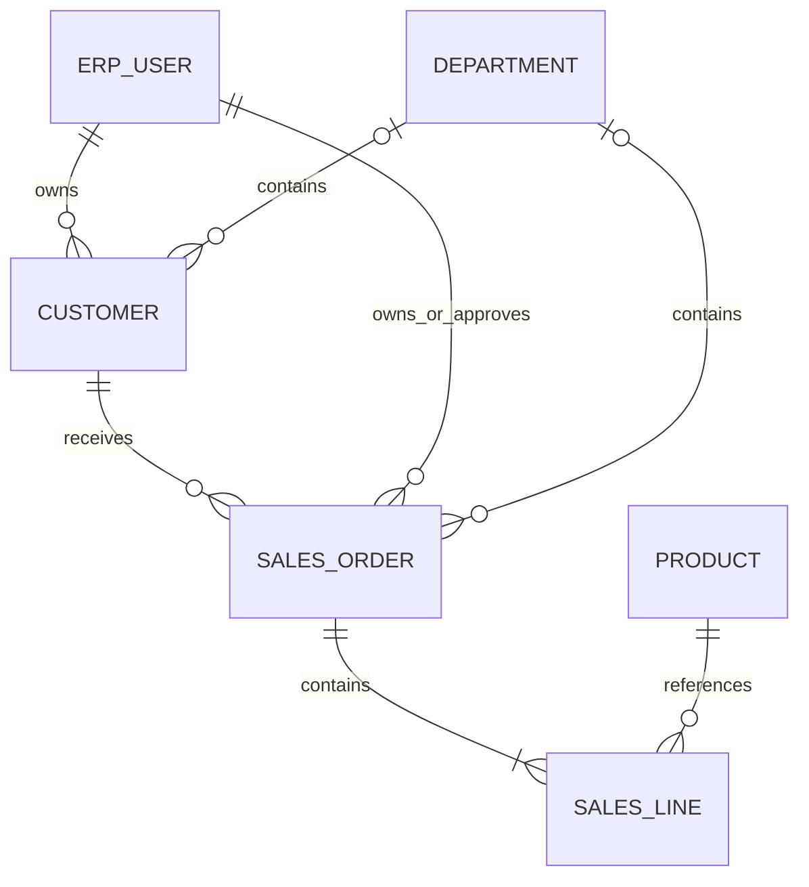

# 客户与销售订单（v1.0.6 开发切片）

## 边界与依赖

Web SalesView → sales_api → sales application service → 同一权限引擎/authorization_gate → PostgreSQL。客户资料复用受保护通用目录 API。协议入口将来只调用应用服务；当前 OneBot/离线解析不新增销售操作。AI 关闭时可完成全部已交付功能。

## 数据关系（编码前设计）

customer：UUID、唯一 code、name/contact/phone、active、owner_id、department_id、UTC 时间、version。sales_order：UUID、唯一 SO-UUID 单号、customer_id、服务端 owner/department、显式 currency、Decimal total、note、status、approved_by、UTC 时间、version。sales_line：UUID、order_id、正整数 line_number（订单内唯一）、product_id、正数 quantity NUMERIC(18,4)、非负 unit_price/amount NUMERIC(18,2)。数据库维护外键、唯一与检查约束。

独立新增迁移，不改已发布迁移；不创建样例客户或订单。含客户/销售历史时禁止破坏性降级；无记录时可降级。

## 规则与状态机

- draft → submitted → approved；draft/submitted/approved 可 cancelled。终态不可编辑。草稿编辑完整替换明细，所有命令要求当前 version；同一事务持有授权 Gate 与订单行锁。
- 金额不接受 float/bool；每行 quantity × unit_price 必须精确到分并在 NUMERIC 上限内，总额须在上限内，不默默舍入。
- 提交/审批使用现有 supported_currencies/tax_mode 配置；未配置或非 no_tax 拒绝。税费、汇率、折扣、账期、退货、冲销待确认，不自动推断。
- 销售创建人不能自批（销售始终要求独立审批）。approved 表示订单审核通过；本切片不预留库存，不产生出库记录。出库与库存不足/并发扣减在下一切片实现。
- 客户/商品须当前可读且启用；更新/取消可处理已停用引用，但仍须读取引用权限。只读列表/详情 SQL 在分页前同时过滤客户和所有明细商品，隐藏关系 ID 不泄露。
- 新 resources：customers（read/create/update）、sales_orders（read/create/update/submit/approve/cancel）。统一 own/department/departments/records/all 范围、显式拒绝优先、条件和 requires_approval。新资源不会自动授予已有角色；新安装 bootstrap 显式生成规则。
- 创建归属只取服务器当前身份，不接受 owner/department/status/total/approved_by。编辑校验旧/新资源和提交字段，读取金额按 total/unit_price/line_amount 最严格策略共同隐藏或脱敏。
- 订单、明细、outbox、审计同事务；响应按当前读取权限投影，写入成功但无法读取时仅返回 saved。失败不留下订单/明细/outbox。

## 前端与接口（已实现）

客户资料可创建、编辑、停用；销售页包括分页、状态筛选、详情、明细增删、精确小数文本输入、当前版本提交/独立审批/取消、错误与空态、手机布局。选项来自当前可读前100条资料，明确说明范围；后端仍最终授权。

GET/POST /api/v1/sales_orders；GET/PATCH /api/v1/sales_orders/{id}；POST /{id}/submit|approve|cancel。状态筛选要求状态字段可读，cursor 要求 ID 可读。无导出/聚合旁路。

## 验收范围与结果

真实运行 SQLite/PostgreSQL：跨用户/部门越权、字段/金额投影、引用拒绝与分页、旧/新条件、版本冲突、独立审批、配置安全默认、金额边界、事务回滚、并发编辑/审批、迁移一致性与升级/降级保护。Chromium 验证客户资料→销售草稿→编辑→提交→独立审批，并检查手机页面。

实际双数据库回归288 passed、9 SQLite行锁场景跳过；Chromium全套11 passed，手机布局收尾后销售定向1 passed（13.6秒），最终截图已检查。包含真实客户/销售页面与不同账号独立审批，原始验证边界见IMPLEMENTATION.md及docx/version.md。
