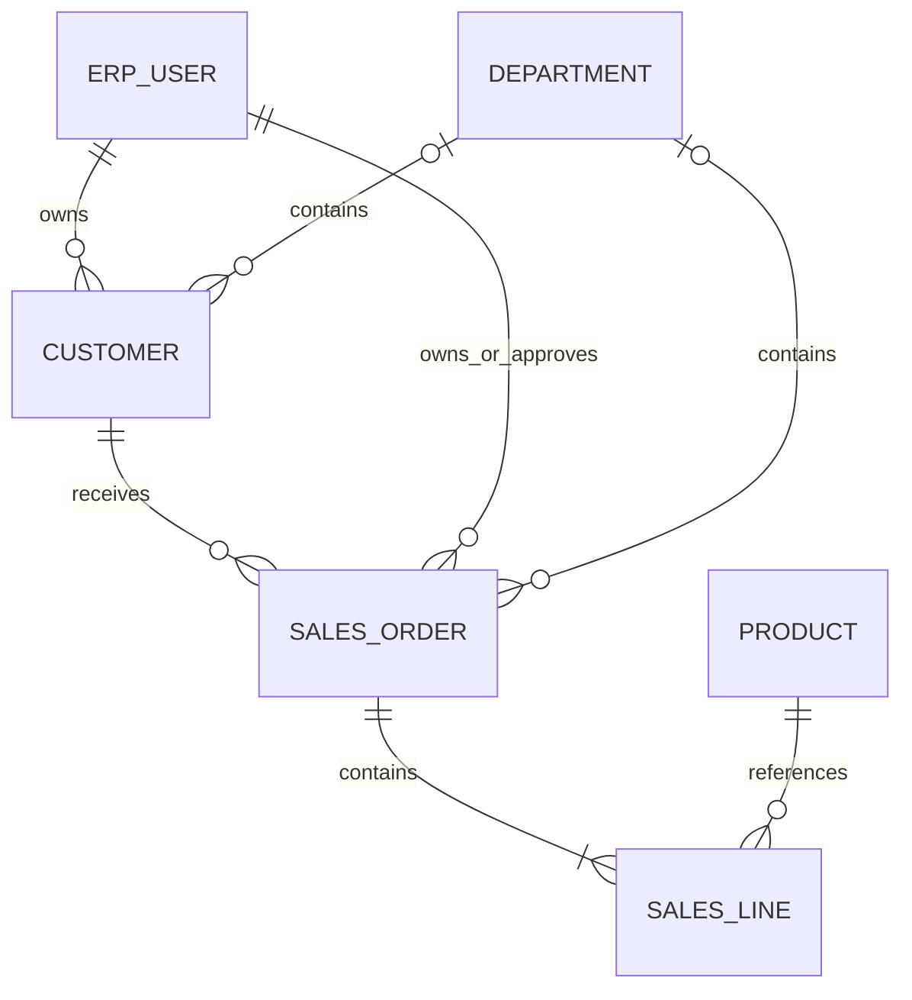
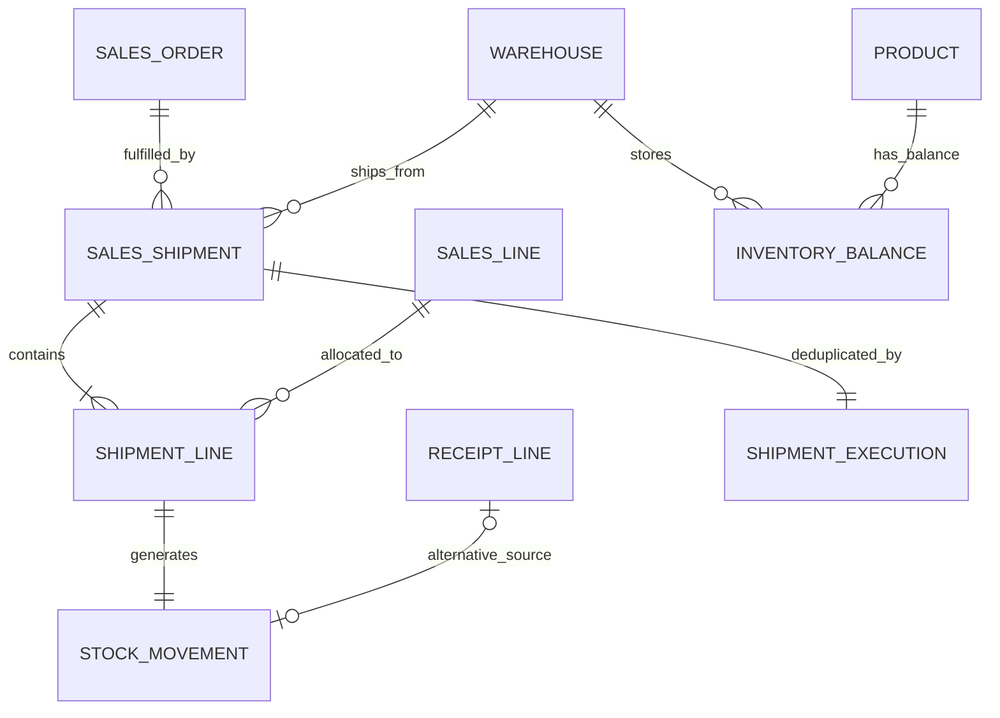

# 采购、销售、库存与报表

[文档导航](README.md) · [版本日志](version.md) · [当前验收](IMPLEMENTATION.md)

当前范围以实施记录为准；下文保留必要的架构、升级与历史依据。

[采购与入库](#procurement) · [客户与销售订单](#sales) · [销售出库](#shipments) · [分析与报表](#reports)

## 采购与入库

当前已实现分类、供应商、仓库、采购草稿与明细、提交/独立审批/取消、带版本和幂等键的分批入库、库存/流水/收货查询、明确业务规则配置以及相应Web页面。当前不支持通用工作流、退货、冲销、含税与汇率换算。

### 数据与依赖（先于业务代码建立）

category → product；supplier → purchase_order → purchase_line → purchase_receipt → receipt_line → stock_movement。
warehouse + product → inventory_balance（复合唯一）。
command_execution 以 subject + idempotency key 唯一约束防重复；业务数据、命令记录、流水、余额、审计、outbox 同事务提交。

金额 NUMERIC(18,2)，数量 NUMERIC(18,4)。不使用浮点数，不静默四舍五入：超过精度或行金额不能精确到分则拒绝。订单显式填写币种，提交、审批和新入库前必须在系统配置中确认支持币种与无税模式。税率、多币种换算尚未实现。

状态：draft → submitted → approved → partially_received → received。draft 可编辑；无收货前可取消；完成收货只能后续通过冲销流程调整，当前不提供物理删除、退货和超收。
默认需要另一位有审批权限的人员批准，禁止自审批。管理员可以显式配置该规则；无配置时采用安全默认值。

创建和每次状态变更都从服务端身份解析所有者/部门；引用的商品、供应商、仓库必须当前可读。读取关联数据再次检查其权限，隐藏成本同时隐藏单价、行金额、总额，不能通过嵌套对象绕过字段约束。

入库要求订单receive、仓库receive、收货单create权限。事务先锁authorization_gate，再锁订单、明细和余额；按稳定ID顺序锁定。收货数量不能超过剩余数量，库存只通过不可变流水改变。幂等重试重新授权并重新投影，不能返回过期权限下的缓存响应。

### 接口

/api/v1/categories、suppliers、warehouses：受保护资料维护。
/purchase_orders：草稿创建、列表、详情、草稿修改。
/purchase_orders/{id}/submit、approve、cancel：显式状态转换。
/purchase_orders/{id}/receive：带Idempotency-Key和订单版本的入库命令。
/purchase_receipts、inventory_balances、stock_movements：只读受限查询。
/system_configuration：已授权管理员显式配置业务规则；新增模块不自动扩大现有策略权限。

已成功收货的重放仅回读当前授权下的回执，不执行新入库；业务配置停用不会删除或重写历史流水。

## 客户与销售订单

### 边界与依赖

Web SalesView → sales_api → sales application service → 同一权限引擎/authorization_gate → PostgreSQL。客户资料复用受保护通用目录 API。协议入口将来只调用应用服务；当前 OneBot/离线解析不新增销售操作。AI 关闭时可完成全部已交付功能。

### 数据关系（编码前设计）

customer：UUID、唯一 code、name/contact/phone、active、owner_id、department_id、UTC 时间、version。sales_order：UUID、唯一 SO-UUID 单号、customer_id、服务端 owner/department、显式 currency、Decimal total、note、status、approved_by、UTC 时间、version。sales_line：UUID、order_id、正整数 line_number（订单内唯一）、product_id、正数 quantity NUMERIC(18,4)、非负 unit_price/amount NUMERIC(18,2)。数据库维护外键、唯一与检查约束。

独立新增迁移，不改已发布迁移；不创建样例客户或订单。含客户/销售历史时禁止破坏性降级；无记录时可降级。

### 规则与状态机

- draft → submitted → approved → partially_shipped → shipped；未发生出库时draft/submitted/approved可cancelled。终态不可编辑。草稿编辑完整替换明细，所有命令要求当前 version；同一事务持有授权 Gate 与订单行锁。
- 金额不接受 float/bool；每行 quantity × unit_price 必须精确到分并在 NUMERIC 上限内，总额须在上限内，不默默舍入。
- 提交/审批使用现有 supported_currencies/tax_mode 配置；未配置或非 no_tax 拒绝。税费、汇率、折扣、账期、退货、冲销待确认，不自动推断。
- 销售创建人不能自批（销售始终要求独立审批）。approved表示订单审核通过，不预留库存；实际出库按当前库存扣减，产生不可变发货记录和流水。详见[销售出库](BUSINESS.md#shipments)。
- 客户/商品须当前可读且启用；更新/取消可处理已停用引用，但仍须读取引用权限。只读列表/详情 SQL 在分页前同时过滤客户和所有明细商品，隐藏关系 ID 不泄露。
- 新 resources：customers（read/create/update）、sales_orders（read/create/update/submit/approve/cancel/ship）。统一 own/department/departments/records/all 范围、显式拒绝优先、条件和 requires_approval。新资源不会自动授予已有角色；新安装 bootstrap 显式生成规则。
- 创建归属只取服务器当前身份，不接受 owner/department/status/total/approved_by。编辑校验旧/新资源和提交字段，读取金额按 total/unit_price/line_amount 最严格策略共同隐藏或脱敏。
- 订单、明细、outbox、审计同事务；响应按当前读取权限投影，写入成功但无法读取时仅返回 saved。失败不留下订单/明细/outbox。

### 前端与接口（已实现）

客户资料可创建、编辑、停用；销售页包括分页、状态筛选、详情、明细增删、精确小数文本输入、当前版本提交/独立审批/取消、错误与空态、手机布局。选项来自当前可读前100条资料，明确说明范围；后端仍最终授权。v1.0.7增加已发数量、出库表单/记录，详情按当前可读shipped_quantity字段隐藏或脱敏，旧角色需显式授权。

GET/POST /api/v1/sales_orders；GET/PATCH /api/v1/sales_orders/{id}；POST /{id}/submit|approve|cancel。状态筛选要求状态字段可读，cursor 要求 ID 可读。无导出/聚合旁路。

### 验收范围与结果

真实运行 SQLite/PostgreSQL：跨用户/部门越权、字段/金额投影、引用拒绝与分页、旧/新条件、版本冲突、独立审批、配置安全默认、金额边界、事务回滚、并发编辑/审批、迁移一致性与升级/降级保护。Chromium 验证客户资料→销售草稿→编辑→提交→独立审批，并检查手机页面。

v1.0.6基础切片的历史双数据库回归288 passed、9 SQLite行锁场景跳过；Chromium全套11 passed，手机布局收尾后销售定向1 passed（13.6秒），最终截图已检查。包含真实客户/销售页面与不同账号独立审批，当前出库验收见[实施记录](IMPLEMENTATION.md)及[版本日志](version.md)。

## 销售出库

### 边界与关系（先于编码）

Web销售页/库存页 → sales_api → shipment服务 → sales订单规则/统一权限 → PostgreSQL事务。库存不可经通用CRUD写入；OneBot/AI本切片不增加出库工具。

新增sales_shipment（唯一发货号、订单/仓库/当前操作者与部门外键、UTC时间、版本）、shipment_line（发货单/销售行/商品外键、正数NUMERIC(18,4)数量、发货单内销售行唯一）、shipment_execution（当前用户/销售出库专用幂等键唯一、参数摘要、发货单外键）。三表追加后不可更新/删除，PG禁止TRUNCATE。

sales_line新增shipped_quantity，旧数据回填0，约束0≤已发≤计划。sales_order扩展状态approved→partially_shipped→shipped；已发货禁止直接取消或编辑，退货/冲销须后续独立流程。stock_movement仍保存正数数量，通过kind区分purchase_receipt增加、sales_shipment减少；receipt_line_id与新增shipment_line_id须按kind互斥且唯一。既有采购流水与不可变触发器必须保留。

### 命令、授权与一致性

POST /api/v1/sales_orders/{id}/ship：Header Idempotency-Key；body含原订单version、warehouse_id、至少一行{line_id,quantity}，最多100行，禁止重复行、浮点、额外身份字段。GET /api/v1/sales_shipments提供当前授权列表/详情，订单筛选及游标要求可读字段。

出库须当前sales_orders.ship、warehouses.ship、sales_shipments.create（warehouse_id/order_id/lines可写），以及客户/商品/仓库可读、目标库存id/quantity当前可读。新增动作/资源/字段不自动授权旧角色。不存在与不可读库存统一拒绝，不返回隐藏数量。

先锁authorization_gate→订单→销售行（稳定ID）→库存余额（稳定商品ID）。按商品合计本次需求，重复商品多行不能分别绕过库存不足；整单任一行超计划/库存不足，事务全部回滚。新发货要求客户、商品、仓库启用，币种/no_tax仍有效；原订单及发货后的新状态均重新授权。

同事务写入发货单/明细、正数出库流水、减少库存、累计已发、推进订单版本/状态、幂等记录、outbox及审计。流水/发货/命令记录不可变。销售审批本身仍不预留库存；本切片不支持单张出库单跨仓分配或负库存、运费、税费、批次/序列号、成本计价或退货。

幂等按当前用户+销售出库命名空间隔离；摘要包含操作/原订单版本/仓库/规范化明细。相同键同参数只投影已有发货单，不再次扣库存；不同参数409。重放重查当前ship/create/关联读取权限，配置或资料停用不重写历史结果；无当前读取权限拒绝。新发货成功但缺少回读发货权限时只返回saved。

sales_orders新增虚拟字段shipped_quantity，控制每行已发数量读取/脱敏；旧角色lines可读也不会自动获得新字段。前端需显式读此字段才显示发货入口，后端仍按ship/create动作最终授权。

### 查询与前端

出库记录在SQL分页前过滤发货自身、仓库、销售订单及其客户/全部商品；库存流水按采购来源或销售来源的当前读取范围过滤，不因新增出库绕过旧采购关系权限。字段仍经统一投影；出库不返回订单价格。销售行已发数量与lines字段同受保护。

销售页显示计划/已发数量、部分/全部出库状态和发货表单，确认本次实际出库数量。请求结果不明时冻结原body/原幂等键供重试，避免自动生成新命令。库存页增加销售出库单、方向说明及真实记录，支持桌面/手机。

### 迁移与验收

新增ce1a0b9c8d7e迁移，不改已发布文件。离线停止旧后端后迁移；SQLite重建表需恢复全部索引/触发器并检查外键，PG使用事务内ALTER。有任何出库历史或已发数量时拒绝破坏性降级；无出库时允许回到be0f9a8b7c6d且保留旧采购/销售数据。

真实验收：SQLite/PostgreSQL完整回归；同一订单并发发货、不同订单争抢同一库存、并发相同幂等键、重复商品合计、权限撤销/字段/来源隔离、版本/状态、回滚与不可变触发器；旧版本带真实采购流水/销售明细升级与降级保护。Chromium验证采购入库→销售分批出库→库存/流水/发货记录及手机布局。

实际验收（2026-10-22）：最终双数据库331 passed、12 skipped，156.28秒；Chromium全套12 passed（1.2分钟）。包括真实提交成功后断响应并重试、库存不足不扣减、分批出入库到库存0，以及三类PostgreSQL发货并发。桌面/390px截图已检查，边界见[实施记录](IMPLEMENTATION.md)。

## 分析与报表

### 已实现的范围

报表是模块化单体内的只读应用服务，Web → reports_api → reports → 现有权限引擎/业务查询 → PostgreSQL；没有独立数据副本、AI依赖或新业务表。本阶段不改变数据库结构，不需要新迁移。

同一Gate事务内读取当前策略。inventory、movements、purchases、sales四类报表，分别绑定inventory_balances、stock_movements、purchase_orders、sales_orders。报表要求read与report交集；CSV另要求export交集。每个动作的显式拒绝、条件、范围、字段最严约束和待审批限制均在聚合前应用。旧角色不会自动获得新增动作。

库存按仓库/商品展示当前实际余额，流水按仓库/商品/方向汇总实际发生数量；采购与销售按状态/币种汇总订单数，可显式选择金额指标。金额要求total、unit_price、line_amount均可读。不计算利润、成本、预警阈值或汇率。不同商品/单位和币种不合计。订单金额不是现金流或收入确认。

所有报表沿用业务查询中的商品、仓库、客户/供应商和来源单据可见性，关联维度展示前额外检查字段。隐藏/脱敏字段的行不参与相应报表，不返回被排除行数。筛选只作用于完整可读的维度。零结果既可能是无记录，也可能是当前授权范围没有合格记录。

每次最多10000条合格来源记录、200组；超限整体拒绝，要求缩小筛选，不返回部分汇总。数据库计算聚合，不加载完整业务对象或逐行查询。PostgreSQL报表每条SQL使用5秒statement_timeout；SQLite开发环境使用临时progress handler约束查询时间。CSV只导出当前筛选下完整合格汇总，防公式注入，记录种类、指标、行数与策略版本等元数据，不记录业务金额或下载内容。

### API约定

GET /api/v1/reports/{inventory|movements|purchases|sales}

GET /api/v1/reports/{inventory|movements|purchases|sales}/export

查询参数：metric=count|amount（只适用于订单，默认count）；warehouse_id/product_id（库存/流水），status/currency（订单），kind（流水）。参数白名单与长度校验，错误类别统一422；当前版本不提供日期维度，避免未授权时间字段旁路。

返回items为完整合格分组，source_rows仅为合格来源条数，policy_revision为当前策略号。字段或条件变化后不复用旧结果。前端按报表及已应用筛选建立查询键，查询错误时不展示旧数据，导出每次重新授权。

### 报表与授权对照

| 页面       | 主资源             | 分组                   | 指标                     |
| ---------- | ------------------ | ---------------------- | ------------------------ |
| 当前库存   | inventory_balances | 仓库、商品及原单位     | 实际余额                 |
| 出入库汇总 | stock_movements    | 仓库、商品、单位、kind | 正数发生量，方向分别展示 |
| 采购汇总   | purchase_orders    | status、currency       | 订单数，或订单数与金额   |
| 销售汇总   | sales_orders       | status、currency       | 订单数，或订单数与金额   |

| 参数                      | 适用报表   | 取值                              |
| ------------------------- | ---------- | --------------------------------- |
| warehouse_id / product_id | 库存、流水 | 完整可读ID，最多80字符            |
| kind                      | 流水       | purchase_receipt / sales_shipment |
| status                    | 订单       | 对应采购或销售的合法业务状态      |
| currency                  | 订单       | 三位大写ASCII币种代码             |
| metric                    | 订单       | count（默认）/ amount             |

参数不能跨报表使用。未知参数、非法状态/币种和非订单的amount指标返回422。当前没有日期筛选与趋势报表。

### 管理员授权顺序

1. 在「权限中心」选择用户或角色，先配置主资源read及业务引用的读取范围。
2. 显式增加主资源report，配置相同或更小的数据范围；需要下载时再配置export。read不自动包含report，report不自动包含export。
3. 为每个动作配置本报表所需字段：库存需要warehouse_id/product_id/quantity，流水另需kind；订单数量需要status/currency，金额另需total/unit_price/line_amount。
4. 库存维度还需商品id/sku/name/unit和仓库id/code/name可读；业务订单与流水保留原有来源单据、客户/供应商与全部商品约束。
5. 使用模拟器检查单个记录的report/export决策，再使用目标账号检查完整报表。模拟器不替代关联和分组约束。

未授予某动作的可执行允许规则时返回403；存在规则但当前范围内全部被拒绝、待审批或字段不完整时，返回零条合格记录，CSV只有表头。前端不会显示被排除的行数。页面表格在重新校验或请求失败期间隐藏旧结果；导出不复用表格旧缓存。

### 导出与运行边界

CSV为UTF-8 BOM，固定列名，保留十进制文本精度。文本单元格以=、+、-、@或危险空白前缀开头时加单引号，避免电子表格解释为公式。文件名固定为报表类型，不包含用户输入。

超出来源/分组上限返回422（report_source_limit/report_group_limit）；数据库超时返回503（report_query_timeout），事务回滚后记录失败审计。PostgreSQL超时约束为每条SQL5秒，SQLite临时progress handler覆盖报表查询。报表仍使用全局Gate，规模上限不代表生产性能已验收。本版没有库存成本、利润、现金流、BI、异步导出或AI查询能力。
