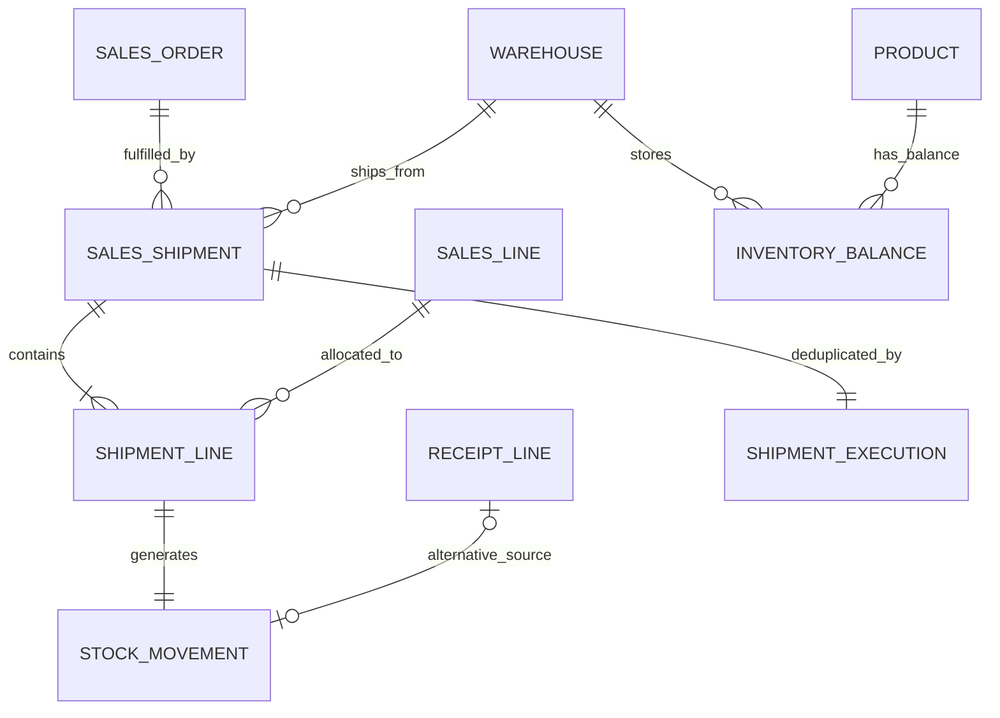

# 销售出库（v1.0.7 已实现）

[文档导航](README.md) · [版本日志](version.md)

## 边界与关系（先于编码）

Web销售页/库存页 → sales_api → shipment服务 → sales订单规则/统一权限 → PostgreSQL事务。库存不可经通用CRUD写入；OneBot/AI本切片不增加出库工具。

新增sales_shipment（唯一发货号、订单/仓库/当前操作者与部门外键、UTC时间、版本）、shipment_line（发货单/销售行/商品外键、正数NUMERIC(18,4)数量、发货单内销售行唯一）、shipment_execution（当前用户/销售出库专用幂等键唯一、参数摘要、发货单外键）。三表追加后不可更新/删除，PG禁止TRUNCATE。

sales_line新增shipped_quantity，旧数据回填0，约束0≤已发≤计划。sales_order扩展状态approved→partially_shipped→shipped；已发货禁止直接取消或编辑，退货/冲销须后续独立流程。stock_movement仍保存正数数量，通过kind区分purchase_receipt增加、sales_shipment减少；receipt_line_id与新增shipment_line_id须按kind互斥且唯一。既有采购流水与不可变触发器必须保留。

## 命令、授权与一致性

POST /api/v1/sales_orders/{id}/ship：Header Idempotency-Key；body含原订单version、warehouse_id、至少一行{line_id,quantity}，最多100行，禁止重复行、浮点、额外身份字段。GET /api/v1/sales_shipments提供当前授权列表/详情，订单筛选及游标要求可读字段。

出库须当前sales_orders.ship、warehouses.ship、sales_shipments.create（warehouse_id/order_id/lines可写），以及客户/商品/仓库可读、目标库存id/quantity当前可读。新增动作/资源/字段不自动授权旧角色。不存在与不可读库存统一拒绝，不返回隐藏数量。

先锁authorization_gate→订单→销售行（稳定ID）→库存余额（稳定商品ID）。按商品合计本次需求，重复商品多行不能分别绕过库存不足；整单任一行超计划/库存不足，事务全部回滚。新发货要求客户、商品、仓库启用，币种/no_tax仍有效；原订单及发货后的新状态均重新授权。

同事务写入发货单/明细、正数出库流水、减少库存、累计已发、推进订单版本/状态、幂等记录、outbox及审计。流水/发货/命令记录不可变。销售审批本身仍不预留库存；本切片不支持单张出库单跨仓分配或负库存、运费、税费、批次/序列号、成本计价或退货。

幂等按当前用户+销售出库命名空间隔离；摘要包含操作/原订单版本/仓库/规范化明细。相同键同参数只投影已有发货单，不再次扣库存；不同参数409。重放重查当前ship/create/关联读取权限，配置或资料停用不重写历史结果；无当前读取权限拒绝。新发货成功但缺少回读发货权限时只返回saved。

sales_orders新增虚拟字段shipped_quantity，控制每行已发数量读取/脱敏；旧角色lines可读也不会自动获得新字段。前端需显式读此字段才显示发货入口，后端仍按ship/create动作最终授权。

## 查询与前端

出库记录在SQL分页前过滤发货自身、仓库、销售订单及其客户/全部商品；库存流水按采购来源或销售来源的当前读取范围过滤，不因新增出库绕过旧采购关系权限。字段仍经统一投影；出库不返回订单价格。销售行已发数量与lines字段同受保护。

销售页显示计划/已发数量、部分/全部出库状态和发货表单，确认本次实际出库数量。请求结果不明时冻结原body/原幂等键供重试，避免自动生成新命令。库存页增加销售出库单、方向说明及真实记录，支持桌面/手机。

## 迁移与验收

新增ce1a0b9c8d7e迁移，不改已发布文件。离线停止旧后端后迁移；SQLite重建表需恢复全部索引/触发器并检查外键，PG使用事务内ALTER。有任何出库历史或已发数量时拒绝破坏性降级；无出库时允许回到be0f9a8b7c6d且保留旧采购/销售数据。

真实验收：SQLite/PostgreSQL完整回归；同一订单并发发货、不同订单争抢同一库存、并发相同幂等键、重复商品合计、权限撤销/字段/来源隔离、版本/状态、回滚与不可变触发器；旧版本带真实采购流水/销售明细升级与降级保护。Chromium验证采购入库→销售分批出库→库存/流水/发货记录及手机布局。

实际验收（2026-10-22）：最终双数据库331 passed、12 skipped，156.28秒；Chromium全套12 passed（1.2分钟）。包括真实提交成功后断响应并重试、库存不足不扣减、分批出入库到库存0，以及三类PostgreSQL发货并发。桌面/390px截图已检查，边界见[实施记录](IMPLEMENTATION.md)。
